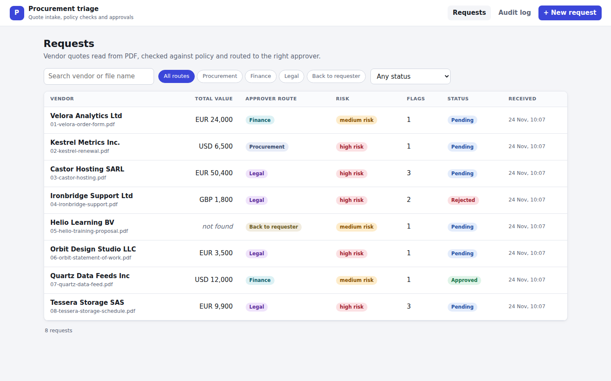
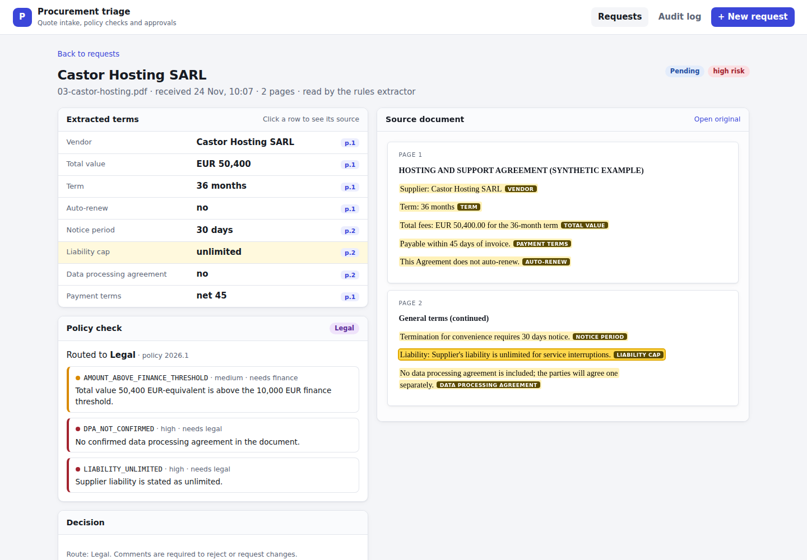
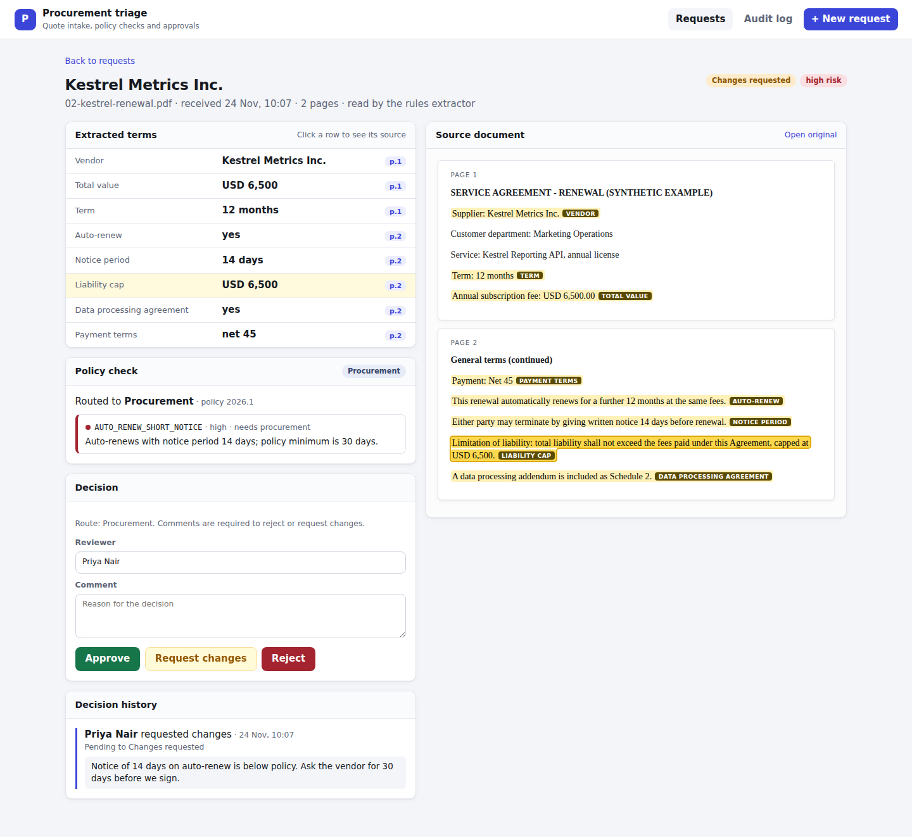
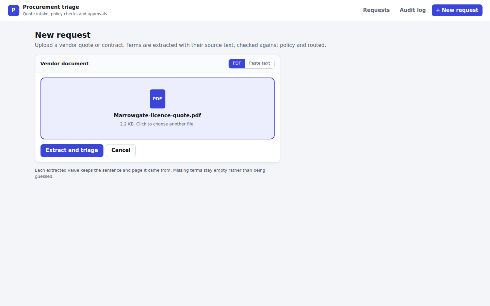
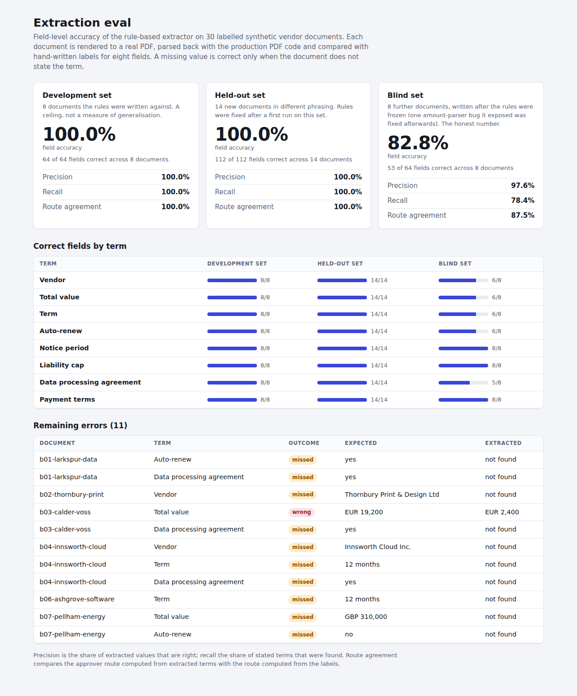
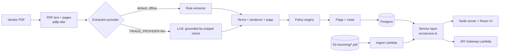

# Purchase request triage


*23-second demo: a PDF quote is uploaded, its terms are extracted with highlighted source sentences, policy flags and an approver route appear, a reviewer requests changes with a comment, and the decision shows up in the audit log ([MP4](docs/demo.mp4)).*

Vendor quotes arrive as PDFs. This service reads them, extracts the commercial terms that matter (value, term,
auto-renewal and notice, liability cap, DPA, payment terms), checks them against a policy file, routes the request to the
right approver and records every decision. Each extracted value keeps the sentence and page it came from, so a reviewer
checks evidence instead of trusting a number. All vendors and documents are synthetic.

TypeScript end to end: Node service layer, React UI, Postgres, and the same service layer deployed as AWS Lambda handlers
(CDK stack included, synthesised and tested locally, never deployed).

## Screenshots



*Request list: search, approver-route chips, status filter, risk and status badges.*



*Detail: every term links to its source sentence and page; the active term is highlighted in the parsed PDF text next to the policy flags and route.*



*Decision: reviewer and comment are recorded in the audit history (a comment is mandatory for reject or request changes).*



*Intake: drop a text-based PDF (or paste text); it is parsed, extracted and routed on upload.*



*Eval report: field accuracy on 30 labelled documents, split into development, held-out and blind sets, with every remaining error listed.*

## What it does

1. **PDF intake.** Text is extracted from PDFs with `pdfjs-dist`. Wrapped lines are merged back into paragraphs and
   sentences, and every value keeps its page number. Plain text can also be pasted. Scanned PDFs without a text layer
   are rejected with a clear message (no OCR).
2. **Extraction.** Eight terms, rule-based and offline by default. Missing terms stay empty ("not found") rather than guessed.
   An optional OpenAI-compatible provider (`TRIAGE_PROVIDER=llm`) keeps a value only if its snippet appears verbatim in the document.
3. **Policy and routing.** `policy/policy.json` holds six rules (thresholds, FX rates, route order). The approver route is the most senior triggered one:
   requester < procurement < finance < legal.
4. **Review UI.** Filterable list, detail page with highlighted source text, approve / request changes / reject with reviewer and comment, audit log.
   Decisions run in one database transaction with a row lock, so two reviewers cannot both finalise the same request.
5. **Postgres.** Plain SQL migrations (`migrations/`), a repository layer behind a small `Store` interface, an in-memory implementation for unit tests and demo mode.
   Both implementations run the same contract tests, including a concurrent-decision race.
6. **Serverless shape.** One router and service layer, two adapters: the local Node server and API Gateway Lambda handlers. A second Lambda
   ingests PDFs uploaded to S3 (idempotent against duplicate event delivery) and a third applies migrations. `infra/` is a CDK app.

### Policy rules shipped

| Rule | Condition | Route | Severity |
| --- | --- | --- | --- |
| `AMOUNT_ABOVE_FINANCE_THRESHOLD` | total above 10,000 EUR (USD and GBP converted at fixed rates) | finance | medium |
| `AUTO_RENEW_SHORT_NOTICE` | auto-renews and notice is under 30 days or not stated | procurement | high |
| `DPA_NOT_CONFIRMED` | no confirmed data processing agreement | legal | high |
| `LIABILITY_CAP_MISSING` | no quantified liability cap | legal | high |
| `LIABILITY_UNLIMITED` | liability stated as unlimited | legal | high |
| `KEY_TERMS_MISSING` | vendor, amount or term not found | requester | medium |

## Architecture



- `src/document.ts` PDF and text parsing; `src/extract.ts` extraction; `src/policy.ts` rules and routing.
- `src/service.ts` application layer; `src/router.ts` HTTP-shaped routing used by both adapters.
- `src/store.ts` port and in-memory store; `src/pg-store.ts` Postgres; `src/migrate.ts` migration runner with an advisory lock.
- `src/server.ts` Node adapter; `src/lambda/*` Lambda adapters; `infra/` CDK stack; `web/` React UI; `eval/` labelled eval.

## Run it

Requirements: Node 18+, Docker for Postgres.

```bash
npm install
npm run env:init     # writes .env with a random database credential (gitignored; template in .env.example)
npm run db:up        # Postgres 16 in Docker
npm run db:migrate
npm start            # builds the UI, seeds 8 sample PDFs, serves UI + API on http://localhost:8787
npm run db:down      # stop and delete the database volume
```

No Docker? `npm run demo` serves everything from an in-memory store.

Other commands: `npm test` (unit tests; the Postgres suite runs when `.env` is present), `npm run typecheck`,
`npm run triage` (offline report on the sample PDFs), `npm run eval`, `npm run eval:report` (writes `docs/eval-report.html`),
`npm run bundle:lambda`, `npm run infra:test`, `npm run infra:synth`, `npm run screenshots`, `npm run demo:record`.

| Variable | Default | Purpose |
| --- | --- | --- |
| `TRIAGE_PORT` | `8787` | HTTP port (localhost only) |
| `DATABASE_URL` | built from `.env` | Postgres connection URL |
| `TRIAGE_STORE` | `postgres` | `memory` for the zero-setup demo |
| `TRIAGE_PROVIDER` | `rules` | `rules` or `llm` (needs `TRIAGE_LLM_URL`, `TRIAGE_LLM_MODEL`, `TRIAGE_LLM_KEY`) |

## AWS deployment (synthesised, not deployed)

`infra/` is a CDK app (`aws-cdk-lib`): an HTTP API with a `/api/{proxy+}` route to the API Lambda, an S3 bucket whose
`incoming/*.pdf` uploads trigger the ingest Lambda (reserved concurrency 5 to protect the database), a migration Lambda,
and a CloudFront distribution serving the UI bucket and forwarding `/api/*` to the API. Functions read the Postgres URL from an SSM
parameter at cold start with an IAM statement scoped to that one parameter. Six template assertions
(`infra/test/stack.test.ts`) check handlers, route, S3 trigger, private encrypted buckets and the scoped IAM policy.
`npm run infra:synth` writes the CloudFormation template to `infra/cdk.out` without contacting AWS.

The bundled handlers were also exercised locally against the Docker Postgres: migrate, list and a PDF upload through
the API handler all succeeded from `dist/lambda/*.mjs`.

## Results

**Tests.** 61 root tests (vitest, Node 18.19) and 6 infra tests pass, including the Postgres store contract against a real
database, a concurrent-decision race, PDF parsing with page numbers, Lambda handlers, S3 duplicate delivery and the LLM
provider against a stubbed HTTP endpoint. `tsc` for server, UI and infra, the UI build and the Lambda bundle pass.

**Extraction eval** (`npm run eval`): 30 synthetic documents, 240 labelled fields. Each document is rendered to a PDF and read back
through the production parser. Accuracy counts a field as correct when the value matches the label; a missing value is correct
when the document does not state the term.

| Set | Docs | Field accuracy | Precision | Recall | Route agreement |
| --- | --- | --- | --- | --- | --- |
| Development (rules written against it) | 8 | 100.0% (64/64) | 100.0% | 100.0% | 100.0% |
| Held-out, first run before fixes | 14 | 84.8% (95/112) | 97.6% | 83.0% | 78.6% |
| Held-out, after fixes (tuned on it) | 14 | 100.0% (112/112) | 100.0% | 100.0% | 100.0% |
| Blind (written after the rules were frozen) | 8 | 82.8% (53/64) | 97.6% | 78.4% | 87.5% |

Read the blind row as the real expectation: about 83% of fields right on unseen phrasing, errors mostly misses rather than wrong
values. Fixes made after the held-out run: continental number formats (`18.500,00`), notice in months, spelled-out
years, "renews for successive periods" without the word automatic, "no limit on liability", carve-outs such as unlimited
liability for personal injury with a general cap, and vendor names defined in the text. The blind set exposed one more bug
(`£5m` read as 5), fixed afterwards; it first scored 81.3%. The remaining blind errors are listed in the eval report and are
phrasings the rules do not cover (for example "Vendor name:", "From:", "Contract sum", "extended by agreement", DPA stated as "signed").

Triage of the eight sample PDFs (`npm run triage`): finance 2, procurement 1, legal 4, back to requester 1.

## Limitations

- Extraction is rules over sentences. Blind accuracy is about 83%; unusual wording needs more rules or the LLM provider, which is only tested against a stub, not a live model.
- Text-based PDFs only: no OCR for scans and no DOCX.
- No authentication or roles. The reviewer name is typed in and the route is advisory, not enforced.
- The CDK stack has never been deployed. It does not create the database or a VPC (the Postgres URL comes from SSM), has no API authentication, and the UI upload to its bucket is not automated.
- FX rates in the policy file are fixed illustrative values.
- Samples are synthetic and the eval sets are small and written by the author.
