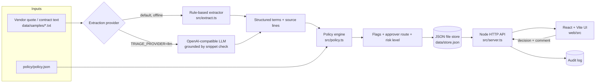

# Purchase request triage (prototype)

A small, finished prototype of a procurement triage flow: vendor quotes and contract text are parsed into
structured terms, checked against a policy file, routed to an approver, and decided in a UI with a full audit log.
All vendors and documents are synthetic.

## Problem

Procurement teams receive vendor quotes with the same handful of commercial terms buried in free text:
total value, term, auto-renewal and notice period, liability cap, data processing agreement (DPA) and payment terms.
Reviewers have to find each term, check it against policy, and decide who must approve. This prototype does the
first two steps automatically and keeps a reviewable trail of every decision, so the reviewer sees the evidence
next to each extracted value.

## What it does

1. **Extraction.** Each document is parsed into eight terms: vendor, total amount and currency, term in months,
   auto-renew, notice days, liability cap, DPA present, payment terms. Every value keeps the verbatim source line it
   came from. Missing terms are reported as "not found" rather than guessed.
2. **Policy and routing.** `policy/policy.json` holds the rules (thresholds, FX rates, route order). Each triggered rule
   produces a flag with a reason. The approver route is the most senior one triggered:
   requester < procurement < finance < legal.
3. **Review UI.** Request list, request detail with terms and source lines, risk flags, route, and
   Approve / Request changes / Reject with a reviewer name and comment. Every decision is written to the audit log.
4. **Optional LLM extraction.** Set `TRIAGE_PROVIDER=llm` with an OpenAI-compatible endpoint. Its values are kept only
   when the returned snippet appears verbatim in the document.

### Policy rules shipped

| Rule | Condition | Route | Severity |
| --- | --- | --- | --- |
| `AMOUNT_ABOVE_FINANCE_THRESHOLD` | total above 10,000 EUR (USD and GBP converted at fixed rates) | finance | medium |
| `AUTO_RENEW_SHORT_NOTICE` | auto-renews and notice is under 30 days or not stated | procurement | high |
| `DPA_NOT_CONFIRMED` | no confirmed data processing agreement | legal | high |
| `LIABILITY_CAP_MISSING` | no quantified liability cap | legal | high |
| `LIABILITY_UNLIMITED` | liability stated as unlimited | legal | high |
| `KEY_TERMS_MISSING` | vendor, amount or term not found | requester | medium |

## Architecture



Files:

- `src/extract.ts` - deterministic, line-based extraction with per-field source lines.
- `src/provider.ts` - extraction interface, rule provider, optional LLM provider, env selection.
- `src/policy.ts` - rule checks, currency conversion, route and risk aggregation.
- `src/ingest.ts` - builds purchase requests from documents.
- `src/store.ts` - JSON-file persistence behind a small interface.
- `src/server.ts` - API (`/api/requests`, `/api/requests/:id`, `/api/requests/:id/decision`, `/api/audit`) and static UI.
- `src/cli.ts` - offline batch report over the sample documents.
- `web/` - React UI.

## How to run

Requirements: Node 18+ and npm. No database or external service is needed.

```bash
npm install
npm test            # extraction and policy tests (vitest)
npm run triage      # offline report for the 8 sample documents
npm run typecheck   # tsc for server and UI
npm run start       # builds the UI and serves it with the API on http://localhost:8787
```

Development: run `npm run server` (API on port 8787) and `npm run dev:web` (Vite on port 5173, proxies `/api`).

Environment variables (all optional):

| Variable | Default | Purpose |
| --- | --- | --- |
| `TRIAGE_PORT` | `8787` | API port (bound to localhost) |
| `TRIAGE_DB` | `data/store.json` | Store file (gitignored) |
| `TRIAGE_PROVIDER` | `rules` | `rules` or `llm` |
| `TRIAGE_LLM_URL` / `TRIAGE_LLM_MODEL` / `TRIAGE_LLM_KEY` | - | Required for `llm`; the key is read from the environment only and never committed |

Persistence choice: the prototype uses a JSON file store instead of SQLite or Postgres, so it runs with zero setup
and no native build. The store sits behind a small class (`src/store.ts`), so a Postgres implementation can replace it.

## Test results

Run on Linux (Node 18.19.1, vitest 2.0.5):

```
 ✓ tests/extract.test.ts  (9 tests)
 ✓ tests/policy.test.ts  (10 tests)
 Test Files  2 passed (2)
      Tests  19 passed (19)
```

Typecheck (`tsc --noEmit` for server and UI) passes. The UI builds with Vite. The API was smoke-tested with curl:
health, list, a rejected decision without a comment (HTTP 400), a request-changes decision with a comment, and the audit entry.

Triage output from `npm run triage` on the eight samples:

| Document | Vendor | Total | Route | Risk | Flags |
| --- | --- | --- | --- | --- | --- |
| 01 velora-order-form | Velora Analytics Ltd | EUR 24,000 | finance | medium | amount above threshold |
| 02 kestrel-renewal | Kestrel Metrics Inc. | USD 6,500 | procurement | high | 14-day notice on auto-renew |
| 03 castor-hosting | Castor Hosting SARL | EUR 50,400 | legal | high | amount, no DPA, unlimited liability |
| 04 ironbridge-support | Ironbridge Support Ltd | GBP 1,800 | legal | high | no DPA, no liability cap |
| 05 helio-training-proposal | Helio Learning BV | not found | requester | medium | key term missing (amount) |
| 06 orbit-statement-of-work | Orbit Design Studio LLC | EUR 3,500 | legal | high | no DPA |
| 07 quartz-data-feed | Quartz Data Feeds Inc | USD 12,000 (EUR 11,040) | finance | medium | amount above threshold |
| 08 tessera-storage-schedule | Tessera Storage SAS | EUR 9,900 | legal | high | 21-day notice, DPA only "on request", no cap |

Routes across the eight documents: finance 2, procurement 1, legal 4, requester 1.

## Limitations

- Extraction is rule-based and line-oriented. It works on the synthetic phrasing in `data/samples`, which is deliberately
  varied but not exhaustive. Real contracts with multi-line clauses or unusual wording will need more rules or the LLM provider.
- Inputs are plain text. PDF and DOCX parsing is not implemented.
- The LLM provider is implemented and grounded, but it was not exercised in tests because no endpoint is available offline.
- FX rates in the policy file are fixed illustrative values, not live rates.
- No authentication, roles or permissions. Any reviewer name is accepted and recorded as typed. The route is advisory: the UI does not block a decision by the wrong approver.
- Persistence is a single JSON file, which is not suitable for concurrent multi-user use.
- The sample vendors, amounts and clauses are fictional.

## Next steps

- Replace the JSON store with Postgres (for example via the existing store interface) and add migrations.
- Deploy the API as AWS Lambda behind API Gateway with DynamoDB or RDS, and the UI as static assets on S3 with CloudFront.
- Add authentication (SSO) and role-based approval routing that enforces the route in the API.
- Add PDF and DOCX connectors, and an evaluation set of labelled contracts to measure extraction precision and recall.
- Connect the decision to the procurement system through a webhook or queue, and add SLA timers for each approval route.
